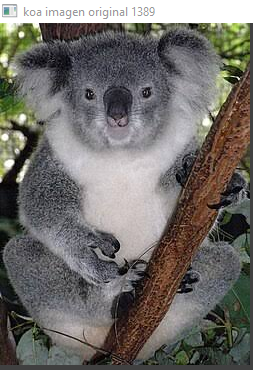
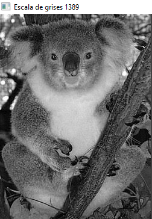
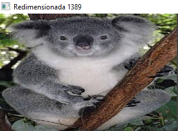
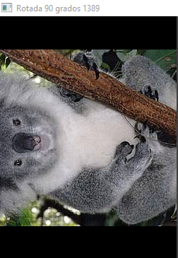
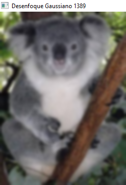
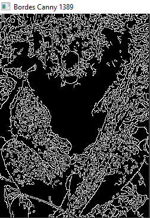
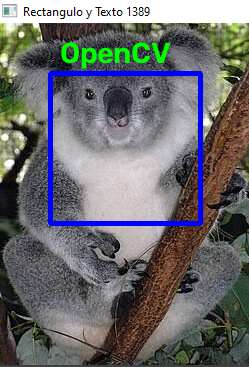
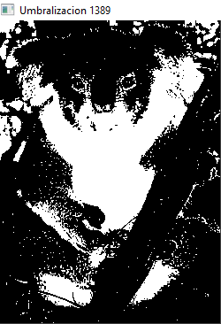
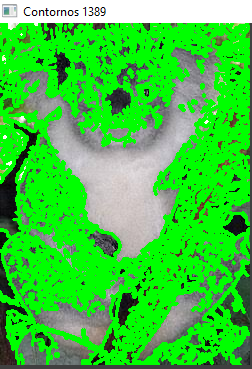

## Operaciones basicascon opencv
## Oscar Flores NC = 1389
# 1. Mostrar la imagen original

# 2. Conversión entre espacios de color

# 3. Cambiar el tamaño de una imagen

# 4. Rotar una imagen

# 5. Desenfocar una imagen

# 6. Detección de bordes mediante el algoritmo de Canny

# 7. Dibujar formas y añadir texto

# 8. Umbralización

# 9. Contours Detection
